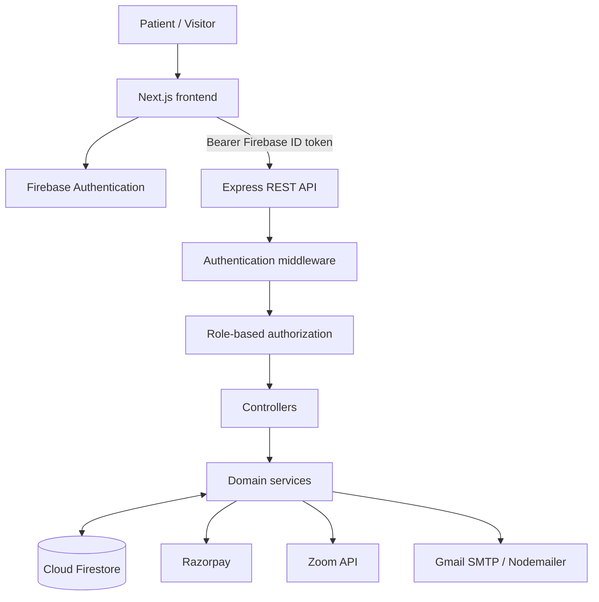
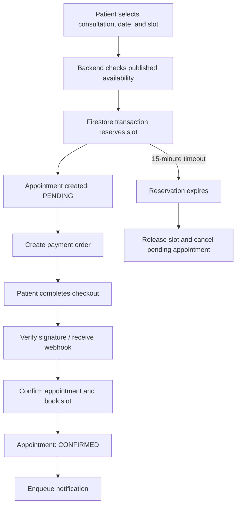

# Dr. Vijay Clinic — Doctor Portfolio, Appointment Booking & Patient CRM

A full-stack clinic platform combining a public-facing doctor portfolio with appointment scheduling, patient workflows, doctor/admin workspaces, payments, clinical records, and online consultation support.

**Repository:** [Hari-prasaath135/Doctor-Portfolio-Appointment-Booking-System-and-Patient-CRM-](https://github.com/Hari-prasaath135/Doctor-Portfolio-Appointment-Booking-System-and-Patient-CRM-)

> **Implementation status:** This document describes the code currently in the repository. Some Next.js API handlers and the doctor dashboard still use in-memory or mock data. Payment/refund and environment configuration also need alignment before production use. See [Known gaps](#known-gaps).

## Contents
- [Overview](#overview)
- [Features](#features)
- [Technology stack](#technology-stack)
- [Architecture](#architecture)
- [Project structure](#project-structure)
- [Roles and access](#roles-and-access)
- [Appointment lifecycle](#appointment-lifecycle)
- [Backend API](#backend-api)
- [Firestore collections](#firestore-collections)
- [Getting started](#getting-started)
- [Environment variables](#environment-variables)
- [Firebase setup](#firebase-setup)
- [Run locally](#run-locally)
- [Build and lint](#build-and-lint)
- [Security](#security)
- [Known gaps](#known-gaps)
- [Deployment](#deployment)
- [Contributing](#contributing)
- [License](#license)

## Overview

The application has two main parts:

1. **Clinic website and patient experience:** a responsive doctor portfolio presenting clinical expertise, services, procedures, achievements, testimonials, articles, contact details, and a protected appointment-booking journey.
2. **Clinic operations backend:** a separately runnable TypeScript/Express API backed by Firebase Authentication and Cloud Firestore. It provides role-aware patient, doctor, and administrator workflows.

The frontend uses the Next.js App Router. The backend exposes REST endpoints under `/api/v1`.

## Features

### Public clinic website
- Doctor profile, hero section, about/expertise, awards, and achievements.
- Medical services and procedure catalogue.
- Testimonials, articles/blog content, and contact sections.
- Clinic location map, responsive navigation, footer, splash screen, and smooth scrolling.
- Website analytics and booking-funnel event tracking.

### Patient workflows
- Google sign-in using Firebase Authentication.
- Protected appointment booking.
- Consultation types: `IN_PERSON`, `VIDEO`, and `FOLLOW_UP`.
- Doctor availability and time-slot discovery.
- Patient details, medical history, and attachment metadata in appointment records.
- Appointment listing, status, cancellation, and rescheduling APIs.
- Patient profile, medical history, prescriptions, and notifications.

### Doctor workflows
- Doctor dashboard route and doctor/admin-protected backend operations.
- Configure/publish schedules, block slots, and mark leave.
- View and manage appointments and consultations.
- Maintain consultation symptoms, diagnosis, notes, recommendations, and follow-up dates.
- Create and update prescriptions.
- Create and retrieve Zoom meetings for video consultations.

### Admin workflows
- Dashboard statistics and analytics insights.
- User listing, role assignment, account activation/deactivation, and deletion.
- Appointment, availability, and slot management.
- Patient enquiry/query workflows.
- Traffic, popular pages, booking funnel, appointment status, and recent-activity metrics.

### Integrations
- Firebase Authentication and Cloud Firestore.
- Razorpay order creation, payment verification, and webhook handling.
- Zoom Server-to-Server OAuth for video meetings.
- Firestore in-app notifications and Nodemailer/Gmail SMTP email implementation.
- Pinelabs refund API code is also present; see [Known gaps](#known-gaps).

## Technology stack

| Area | Technologies |
|---|---|
| Frontend | Next.js 16, React 19, TypeScript |
| Styling/UI | Tailwind CSS 4, shadcn/ui, Base UI, Lucide React |
| Forms/validation | React Hook Form, Zod |
| Authentication | Firebase Authentication, Google OAuth, Firebase Admin SDK |
| Database | Cloud Firestore |
| Backend | Node.js, Express 4, TypeScript |
| Security | Helmet, CORS, Firebase ID-token verification, role middleware |
| Payments | Razorpay; Pinelabs refund implementation |
| Video | Zoom REST API, Server-to-Server OAuth |
| Email | Nodemailer with Gmail SMTP |
| Charts/analytics | Recharts |
| Maps | Mapbox GL |
| Animation | GSAP, Framer Motion, Lenis |

**Persistence note:** Backend services use Firestore. Prisma appears in the frontend dependency list and in TODO comments, but there is no Prisma schema or relational migration setup in the repository.

## Architecture



### Backend request flow

1. The user signs in through Firebase Authentication.
2. The frontend obtains a Firebase ID token and sends `Authorization: Bearer <token>`.
3. Express middleware verifies the token with Firebase Admin and attaches the authenticated user to the request.
4. Role middleware (for example, `requireAdmin` or `requireDoctorOrAdmin`) checks access.
5. Controllers handle HTTP input/output and delegate business logic to services.
6. Services read/write Firestore and call external providers when needed.
7. Response helpers and the global error handler return JSON responses.

## Project structure

```text
.
├── backend/
│   ├── .env.example
│   ├── package.json
│   └── src/
│       ├── app.ts
│       ├── server.ts
│       ├── config/          # Firebase Admin and payment configuration
│       ├── controllers/     # HTTP handlers
│       ├── middleware/      # Authentication, RBAC, validation
│       ├── routes/          # REST route modules
│       ├── services/        # Business logic and integrations
│       ├── types/           # Domain and request types
│       └── utils/           # Errors, logging, response helpers
├── public/                   # Images, logos, static assets
├── src/
│   ├── app/                 # Next.js App Router pages and API routes
│   ├── components/          # Portfolio, booking, dashboard, and UI components
│   └── lib/                 # Firebase clients, auth context, content, validation
├── firestore.rules
├── storage.rules
├── next.config.ts
├── package.json
└── README.md
```

### Backend domains

| Route group | Responsibility |
|---|---|
| `auth` | Verify users, create profiles, resolve roles, revoke tokens |
| `patients`, `doctors` | Patient and doctor profiles |
| `appointments` | Booking, listing, confirmation, cancellation, rescheduling |
| `availability` | Schedules, slots, publishing, blocks, doctor leave |
| `payments`, `refunds` | Payment orders, verification, webhooks, refunds |
| `consultations`, `prescriptions` | Clinical records and prescriptions |
| `medical-history` | Patient medical records |
| `video` | Zoom meeting lifecycle |
| `notifications` | In-app notifications and email |
| `queries` | Patient query workflow |
| `admin`, `analytics` | Admin operations and website insights |

## Roles and access

The backend defines three roles:

| Role | Intended permissions |
|---|---|
| `PATIENT` | Patient-facing booking and access to own records |
| `DOCTOR` | Manage doctor availability and assigned clinical workflows |
| `ADMIN` | Clinic-wide administrative and user-management operations |

Privileged roles are resolved server-side using `ADMIN_EMAIL` and `DOCTOR_EMAIL` and Firebase custom claims. Never trust a role supplied by the browser.

## Appointment lifecycle

The appointment service uses a Firestore transaction to reserve a slot and create a pending appointment. The reservation duration in the service is 15 minutes.



The backend verification/webhook path must be authoritative. A successful checkout redirect by itself is not proof of payment.

## Backend API

Default local API base URL:

```text
http://localhost:5000/api/v1
```

Health check: `GET /api/v1/health`.

| Base path | Representative endpoints | Access |
|---|---|---|
| `/auth` | `POST /verify`, `GET /me`, `POST /revoke` | Authenticated |
| `/patients` | `POST /`, `GET /me`, `GET /`, `GET /:id`, `PUT /:id` | Authenticated; list is admin-only |
| `/doctors` | `GET /`, `GET /:id`, `GET /dashboard`, create/update/deactivate | Public reads; writes restricted |
| `/appointments` | Create/list/get; confirm/complete/cancel/reschedule | Authenticated; confirm/complete doctor or admin |
| `/availability` | Read slots/dates; create schedule, publish, block, mark leave | Public reads; management doctor or admin |
| `/payments` | Create order, verify, payment status, expired-reservation cleanup | Authenticated/protected maintenance |
| `/refunds` | Request refund, retrieve refund records | Authenticated |
| `/consultations` | Create, list own, retrieve, update, complete | Authenticated; writes doctor or admin |
| `/prescriptions` | Create, retrieve, list by patient, update | Authenticated; writes doctor or admin |
| `/medical-history` | Create, retrieve, list by patient, update, delete | Authenticated |
| `/video` | Create, retrieve, delete meeting | Authenticated; create/delete doctor or admin |
| `/notifications` | List own, mark one/all read | Authenticated |
| `/queries` | Submit, list, retrieve, assign, resolve, close | Authenticated |
| `/admin` | Stats, insights, users, role/account management | Admin-only |
| `/analytics` | `POST /events` | Public event ingestion |
| `/webhooks` | `POST /razorpay` | Public provider callback; signature verified |

Example authenticated request:

```bash
curl http://localhost:5000/api/v1/auth/me \
  -H "Authorization: Bearer <FIREBASE_ID_TOKEN>"
```

## Firestore collections

Collection names are centralized in `backend/src/config/firebase.ts`.

| Collection | Purpose |
|---|---|
| `users` | User profile and role |
| `doctors`, `patients` | Doctor and patient profiles |
| `appointments` | Booking, status, payment references |
| `availability` | Doctor schedules and slot state |
| `payments`, `refunds` | Payment and refund records |
| `consultations`, `prescriptions` | Clinical records |
| `medicalHistory` | Patient medical history |
| `patientQueries`, `enquiries` | Patient questions and contact submissions |
| `notifications` | In-app notifications |
| `meetingDetails` | Zoom meeting metadata |
| `analytics` | Website analytics events |
| `webhookEvents` | Payment webhook events |
| `notificationOutbox` | Pending notification work |

Important enums include:
- Appointment: `PENDING`, `CONFIRMED`, `COMPLETED`, `CANCELLED`, `RESCHEDULED`.
- Slot: `AVAILABLE`, `RESERVED`, `BOOKED`, `BLOCKED`.
- Consultation: `IN_PERSON`, `VIDEO`, `FOLLOW_UP`.
- Payment: `CREATED`, `PENDING`, `PAID`, `AUTHORIZED`, `CAPTURED`, `FAILED`, `CANCELLED`, `EXPIRED`, `RECONCILIATION_REQUIRED`, `REFUNDED`, `PARTIALLY_REFUNDED`.

## Getting started

### Prerequisites
- Node.js 20.9 or later (Node.js 22 LTS is suitable).
- npm.
- Firebase project with Google Authentication and Cloud Firestore enabled.
- Firebase Admin credentials for the backend.
- Provider credentials for the integrations you want to enable (Razorpay, Zoom, and email).

### 1. Clone the repository

```bash
git clone https://github.com/Hari-prasaath135/Doctor-Portfolio-Appointment-Booking-System-and-Patient-CRM-.git
cd Doctor-Portfolio-Appointment-Booking-System-and-Patient-CRM-
```

### 2. Install dependencies

Frontend (repository root):

```bash
npm install
```

Backend:

```bash
cd backend
npm install
cd ..
```

### 3. Configure environment files

Create `.env.local` in the repository root and `.env` inside `backend/`. See the examples below. Never commit real secrets, private keys, or service-account JSON files.

### 4. Configure Firebase

Enable Google sign-in, create Firestore, configure authorized domains, and review/deploy the included security rules. See [Firebase setup](#firebase-setup).

## Environment variables

### Frontend — root `.env.local`

The Firebase browser client reads:

```dotenv
NEXT_PUBLIC_FIREBASE_API_KEY=
NEXT_PUBLIC_FIREBASE_AUTH_DOMAIN=
NEXT_PUBLIC_FIREBASE_PROJECT_ID=
NEXT_PUBLIC_FIREBASE_STORAGE_BUCKET=
NEXT_PUBLIC_FIREBASE_MESSAGING_SENDER_ID=
NEXT_PUBLIC_FIREBASE_APP_ID=
```

Some frontend components currently call `http://localhost:5000` directly. Replace these development URLs with a shared API client and a deployment-specific API base URL before deploying.

### Backend — `backend/.env`

Use `backend/.env.example` as a starting point, but note the provider mismatch described below. The inspected backend code reads:

```dotenv
PORT=5000
NODE_ENV=development
FRONTEND_URL=http://localhost:3000

# Firebase Admin SDK: use service-account path OR inline credentials
GOOGLE_APPLICATION_CREDENTIALS=
FIREBASE_PROJECT_ID=
FIREBASE_CLIENT_EMAIL=
FIREBASE_PRIVATE_KEY=

# Server-side privileged role assignment
ADMIN_EMAIL=
DOCTOR_EMAIL=

# Razorpay (current backend config enforces TEST mode)
RAZORPAY_MODE=test
RAZORPAY_KEY_ID=
RAZORPAY_KEY_SECRET=
RAZORPAY_WEBHOOK_SECRET=

# Zoom Server-to-Server OAuth
ZOOM_ACCOUNT_ID=
ZOOM_CLIENT_ID=
ZOOM_CLIENT_SECRET=

# Nodemailer Gmail SMTP
EMAIL_USER=
EMAIL_PASSWORD=
EMAIL_FROM_NAME=Dr. Vijay Clinic
EMAIL_FROM=
```

For inline Firebase credentials, encode private-key line breaks as `\\n`. Keep all private credentials on the server.

**Important:** The checked-in `backend/.env.example` currently describes Pinelabs and Resend settings, but the active payment configuration reads Razorpay variables, the refund service calls Pinelabs, and the notification service configures Nodemailer/Gmail. Align the example file and provider implementation before deployment; do not assume the example alone is complete.

## Firebase setup

1. Create a Firebase project.
2. Enable **Authentication → Google** and add localhost plus deployed domains to authorized domains.
3. Create a Cloud Firestore database.
4. Create a Firebase service account for the backend. Supply credentials via environment variables or a securely mounted secret file.
5. Set the same Firebase project ID in frontend and backend configuration.
6. Review `firestore.rules` and `storage.rules` against the required access model.
7. Deploy rules using the Firebase CLI after configuring the correct project:

```bash
firebase deploy --only firestore:rules,storage
```

The repository contains the rules files; verify your Firebase CLI project configuration before running this command.

## Run locally

Start the backend in terminal 1:

```bash
cd backend
npm run dev
```

The backend uses Nodemon and ts-node and listens on port `5000` by default.

Start the frontend in terminal 2, from the repository root:

```bash
npm run dev
```

Open [http://localhost:3000](http://localhost:3000).

## Build and lint

Frontend:

```bash
npm run lint
npm run build
npm run start
```

Backend:

```bash
cd backend
npm run lint
npm run build
npm start
```

The backend TypeScript build outputs to `backend/dist`.

There is currently no standard `npm test` script or configured test-runner command in either package manifest. Several manually runnable test/verification scripts exist under `backend/src` (booking, analytics, RBAC, and payment-related scripts); inspect their setup before executing them.

## Security

- Verify Firebase ID tokens on the backend; never accept a user ID or role from the request body as proof of identity.
- Keep Firebase Admin credentials, payment secrets, webhook secrets, and Zoom credentials out of frontend code and version control.
- Restrict CORS to the intended frontend origin in production.
- Preserve the raw request body and verify provider signatures for payment webhooks.
- Apply least-privilege Firestore and Storage rules and test them with the Firebase Emulator Suite.
- Enforce record-level authorization for patient, doctor, appointment, consultation, prescription, payment, and medical-history data.
- Use HTTPS, secure secret management, backups, audit logs, monitoring, and retention controls in deployed environments.
- Do not log patient health information, tokens, or payment secrets.

This application handles health-related information. A production release requires dedicated privacy, security, and applicable healthcare/regulatory compliance review. Authentication and security rules alone do not establish compliance.

## Known gaps

These are implementation observations from the current source tree and should be resolved or consciously accepted before production use:

1. **Duplicate/demo appointment flow:** `src/app/api/appointments/route.ts` stores appointments in a process-local array and is marked as a demo. The Express appointment service uses Firestore transactions. Choose one authoritative booking path; the Express/Firestore implementation is the backend domain flow.
2. **Demo availability API:** `src/app/api/availability/route.ts` uses an in-memory object, unlike the Firestore-backed Express availability service.
3. **Contact route is a stub:** `src/app/api/contact/route.ts` logs submissions and returns success; persistence and email are TODOs. The backend also has enquiry/query-related functionality, so choose a single authoritative path.
4. **Doctor dashboard mock data:** `src/app/doctor-dashboard/page.tsx` currently contains sample appointments, slots, and notifications. Connect it to the backend before operational use.
5. **Admin dashboard has mixed data access:** it fetches insights from Express and listens directly to Firestore for enquiries. Confirm this access is intentional and consistent with deployed Firestore rules.
6. **Hard-coded API origin:** multiple frontend components call `http://localhost:5000`; centralize this in environment-based configuration.
7. **Payment/refund provider mismatch:** payment configuration and payment service use Razorpay, while refund service calls Pinelabs. Confirm transaction identifiers and provider compatibility or implement refunds through the original payment provider.
8. **Stale backend env template:** `backend/.env.example` does not fully describe the active Razorpay and Gmail SMTP configuration.
9. **Firebase Admin helper:** `src/lib/firebase-admin.ts` imports `firebase-service-account.json`, which is not present in the repository tree. Verify whether the helper is used; if required, replace the local JSON import with secure server-side credential configuration.
10. **Prisma is not wired as the database:** dependencies/comments mention Prisma, but the inspected services use Firestore and there is no Prisma schema/migration setup.
11. **Email provider mismatch:** current notification code uses Nodemailer/Gmail SMTP, not the Resend SDK described in the backend environment example.
12. **Testing needs standardization:** add a test runner and repeatable integration/CI tests for concurrent booking, payment verification/webhooks, RBAC, and patient-record access.

## Deployment

A typical deployment separates the frontend and backend:

- Deploy the Next.js application to a Node-compatible platform such as Vercel or Render.
- Deploy the Express API as a separate Node.js web service.
- Configure Firebase Authentication, Firestore, security rules, and backend service-account credentials for the production project.
- Set the frontend API base URL to the deployed backend URL and configure backend CORS for the deployed frontend origin.
- Configure external provider credentials and webhook URLs using the provider's production dashboard.
- Add health checks, logs, monitoring, backups, and secret management.

Resolve the known gaps and complete end-to-end security and payment testing before enabling live payments or storing real patient records.

## Contributing

1. Create a feature branch.
2. Keep frontend and backend changes scoped to their respective packages.
3. Add request validation and authorization for new API operations.
4. Test role and record-ownership boundaries.
5. Run frontend and backend lint/build checks.
6. Open a pull request with a summary, test evidence, and any environment changes.

## License

No `LICENSE` file was present in the repository tree when this README was prepared. Add a license file and specify the intended reuse terms before accepting external contributions.
